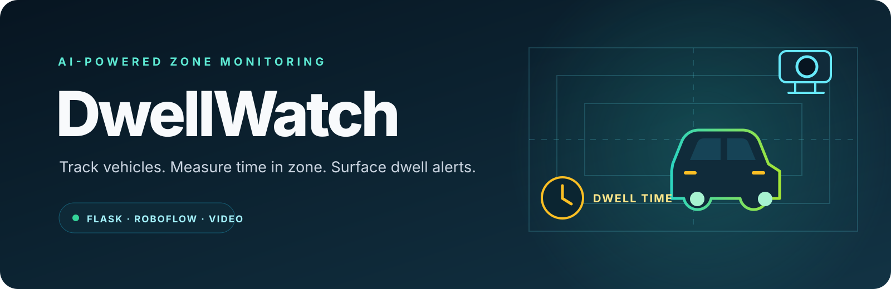

<div align="center">
  
</div>

<div align="center"><strong>A local web dashboard for monitoring vehicle dwell time in configured zones.</strong></div>

## Overview

DwellWatch samples frames from a webcam or video file in your browser and sends them to a Flask application. The application forwards each frame to a local Roboflow Inference Server running the configured **Vehicle Dwell Time Monitor v2** workflow. It displays annotated frames, tracked vehicles, time in zone, violation status, and workflow notification status.

The browser keeps one stream identifier across sampled frames so the workflow tracker can preserve vehicle identity and dwell-time state. The dashboard lets you set the dwell threshold, alert cooldown, and sampling rate. Frames with violations can be saved locally under `outputs/` (ignored by Git).

## Features

- Use a webcam or select a video file in the browser.
- Configure dwell threshold, alert cooldown, and inference sampling rate (2, 3, or 5 FPS).
- View workflow-annotated frames and per-vehicle class, tracker ID, and time in zone.
- Send frames to a local Roboflow Inference Server and display workflow/Slack alert status.
- Save violation frames locally, with a cooldown to avoid repeated writes.
- Run mock tests without a live inference server.

## Requirements

- Python 3.10 or later
- A running Roboflow Inference Server on the machine (default `http://localhost:9001`)
- A Roboflow API key available to the Flask process
- A browser with webcam access, or a video file

## Setup

Create and activate a virtual environment, then install dependencies:

```powershell
python -m venv .venv
.venv\Scripts\Activate.ps1
pip install -r requirements.txt
```

Copy `.env.example` to `.env` if you use a dotenv loader, or set the values in your shell. This project reads environment variables directly and does not currently load `.env` automatically. In PowerShell:

```powershell
$env:ROBOFLOW_API_KEY = "your-key"
$env:INFERENCE_API_URL = "http://localhost:9001" # optional default
python app.py
```

Open [http://localhost:5000](http://localhost:5000). The inference server must be running and configured to fetch the workflow. The Flask client sends the API key in the workflow request body to that server. Keep the key private, and run the dashboard on a trusted local network; the frame endpoint has no user authentication.

## Use

1. Start the inference server and the Flask application.
2. Choose **Webcam** and allow camera access, or select a video file.
3. Set the dwell threshold, alert cooldown, and frame sampling rate.
4. Select **Start**. The dashboard displays the annotated frame, status, and tracked-vehicle table.
5. Select **Stop** to end sampling.

Zones and dwell-time logic are configured in the Roboflow workflow, not in this repository. The workflow is set up for frames around 1920×1080; validate zone geometry for your actual camera or video dimensions.

## Tests

Run the mocked unit and Flask endpoint tests without a live inference server:

```powershell
pytest
```

An optional integration test can use a real image and local inference server. Set `ROBOFLOW_API_KEY` and `SAMPLE_IMAGE` first, then run `pytest`. The standalone `live_mock_test.py` exercises the running Flask route with simulated workflow responses:

```powershell
python live_mock_test.py
```

## Project layout

```
app.py                 Flask routes and alert-frame saving
workflow_client.py     Roboflow Inference Server workflow client
static/index.html      Browser dashboard and webcam/video sampling
tests/                 Mocked unit and endpoint tests
live_mock_test.py      End-to-end Flask test with mock workflow output
assets/                README banner artwork
```

## Configuration

| Variable | Purpose | Default |
| --- | --- | --- |
| `ROBOFLOW_API_KEY` | Key passed to the configured workflow | Required |
| `INFERENCE_API_URL` | Base URL of the local inference server | `http://localhost:9001` |
| `DEBUG` | Enable Flask debug mode when set to `1` | `0` |

The workspace name and workflow ID are currently constants in `workflow_client.py`. The workflow also receives the stream ID, frame number, FPS, dwell threshold, alert cooldown, and active-learning project name.

## License

No license is included in this checkout. Add a license before accepting external contributions or redistributing this project. Roboflow workflow, model, and related assets may have separate terms.
